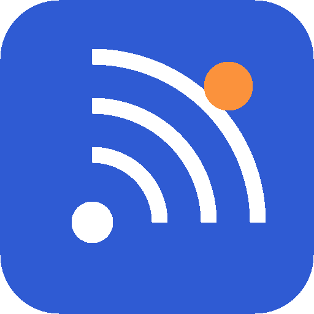
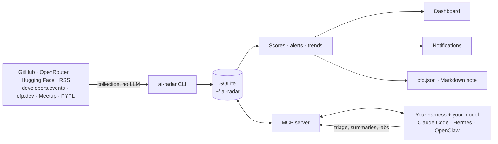

<div align="center">



# ai-radar

**Know about new AI tools the day they ship, not a month later. And learn them without reading everything.**

Every morning ai-radar spots new AI tools, models, papers, conferences and CFPs,
ranks them by how many independent sources talk about them,
and your own model **guides you through them**: what we found, a dense summary, a recall question, then a lab if it is worth practicing.

[Install](#install-in-two-commands) · [The daily session](#the-daily-session) · [How it works](#how-it-works) · [Other harnesses](#with-another-harness) · [Contributing](../../.github/CONTRIBUTING.md)

[](../../LICENSE)
[](https://github.com/mekkiamiri/harness-catalog/actions/workflows/tests.yml)
[](https://code.claude.com/docs/en/plugins)
[](https://modelcontextprotocol.io)

</div>

---

## Why

New agents, the model everyone suddenly talks about, the research topic that takes off: we usually find out weeks later, then lose hours reading. ai-radar fixes both:

- **Early detection** with simple, checkable signals, the same day.
- **Guided learning** instead of a link feed: summaries written from the actual sources, so reading them is optional. Links are stored, offered at the end of each topic, never pushed.

| What | Early signal | Source |
|---|---|---|
| **Tools, agents, MCP, skills** | A recent repo gaining stars fast; several "awesome-X" lists in the same week (a new category is emerging) | GitHub API |
| **Models** | A new id on an aggregator, a trending model | OpenRouter, Hugging Face |
| **Research** | A paper collecting votes | Hugging Face Daily Papers |
| **Articles** | Reference newsletters and blogs | Latent Space, Interconnects, AINews, TLDR AI, Simon Willison, Hacker News |
| **Repos to contribute to** | Repos mentioned by newsletters, growing fast, with good-first-issue tickets and an organization behind them, matching your `[repos] focus` | GitHub API, newsletters |
| **Languages & frameworks** | Languages and frameworks of new AI repos (weekly change); tutorial-search share | GitHub, PYPL |
| **Conferences, meetups, CFPs** (opt-in) | CFP opening, closing in 30/14/7/2 days, date moved; new online events; meetups looking for speakers | developers.events, cfp.dev, Meetup |
| **Everything** | **Resonance**: the same name mentioned by several independent sources within days | Cross-source |

It is a **portable pack**, not another app: it plugs into the harness you already use (Claude Code, Hermes, OpenClaw...) and **uses your model**. Collection, scores and alerts use no LLM at all; your model only triages, summarizes, teaches and builds labs.

## Install in two commands

Requirements: [Claude Code](https://code.claude.com) and [uv](https://docs.astral.sh/uv/getting-started/installation/) (`brew install uv` or `curl -LsSf https://astral.sh/uv/install.sh | sh`).

In Claude Code:

```
/plugin marketplace add mekkiamiri/harness-catalog
/plugin install ai-radar@harness-catalog
```

Or in one line (Claude Code 2.1.275 or later):

```
/plugin install ai-radar --marketplace mekkiamiri/harness-catalog
```

You are asked for an optional **GitHub token** at install time. A token with no scopes is enough; without one, GitHub collection is just slower.

## The daily session

| Command | What it does |
|---|---|
| `/ai-radar:profile` | **Do this first.** Five questions about your level, stack and session language. Stays local. |
| `/ai-radar:morning` | The guided session (about 15 minutes): what we found → you pick → dense summary → one recall question → "to go deeper: link" → next step (lab, try it, move on). |
| `/ai-radar:lab` | A runnable lab (starter code + tests to make pass) one step above your level, with step-by-step guidance. |
| `/ai-radar:schedule` | Runs the radar every morning without any action. |

Or just ask "what's new in AI today?", "should I move from Java to Python for AI?", or "make me a lab on this new MCP server".

**Why summaries plus recall?** The idea is borrowed from book-summary apps: a dense, well-made summary gives the *what* and the *why* in minutes. One recall question helps it stick, and a lab turns it into *know-how*. Every Monday the session adds a few recall questions on last week's topics and a language/framework pulse with an opinion tailored to your stack.

**The weekly digest** (`~/.ai-radar/weekly/YYYY-Www.md`) sums up the week: top 10, rising topics, languages and frameworks, CFPs closing within 30 days, online events.

**The dashboard** (`~/.ai-radar/dashboard/index.html`) keeps every item for **30 days** (starred items stay), ranked by score, with tabs for events and CFPs (sorted by closing date) and language trends. It is a single offline HTML file that can be published as is on GitHub Pages.

### Every morning, automatically

`/ai-radar:schedule` walks you through it. In short:

- **Recommended**: a [Claude Code Desktop scheduled task](https://code.claude.com/docs/en/desktop-scheduled-tasks) at 7:05 with the prompt `/ai-radar:morning scheduled`. If the computer was asleep, the run catches up on wake.
- **Built-in safety net**: when Claude Code starts, if the radar has not run for 20 hours, it runs in the background (one run at a time; set `AI_RADAR_NO_CATCHUP=1` to turn it off).
- **Notifications** (macOS): CFP and online-event alerts go to the notification center, de-duplicated (one alert per event and per step). Elsewhere they are on the dashboard and in the `alerts` tool.
- **On your phone**: set `[phone] ntfy_topic` and subscribe to that topic in the free [ntfy](https://ntfy.sh) app: every run sends one "radar ready" push with the top items and alerts. To run the guided session from the phone, use the Claude app with [Remote Control](https://code.claude.com/docs/en/remote-control) (a session on your computer) or [Dispatch](https://code.claude.com/docs/en/desktop) (the Desktop app).
- **No LLM, free**: [launchd](examples/launchd/io.github.ai-radar.plist) or cron, or [GitHub Actions with GitHub Pages](examples/github-actions/ai-radar.yml).

## How it works



The item score is deliberately **readable** (hover it in the dashboard):

| Part | Points | How |
|---|---|---|
| Freshness | 0 to 30 | Decays over about a week |
| Popularity | 0 to 25 | Stars per day, votes, likes or points depending on the source |
| Resonance | 0 to 45 | 15 per independent source mentioning the name |
| Emergence | 0 or 10 | At least two recent "awesome-X" lists on the same theme |
| Validation | 0 or 15 | Your model judged the item relevant and wrote its summary |

Star farms (the same repo published by dozens of accounts, often malicious lures) are dropped before scoring.

**Conferences and CFPs** are **off by default** (`[events] enabled = true` to turn them on; [`examples/config-fr-jvm.toml`](examples/config-fr-jvm.toml) is a ready-made example). Conferences are kept when online or in your countries and matching your topics. Push notifications are reserved for your **watchlist** (any text file listing the conferences you target, read only) and the conferences you name in `cfp_notify_keywords`; everything else stays on the dashboard. CFP dates are **leads** from community agendas and public CFP APIs: every alert says "verify on the official site".

## Two computers, and your phone (optional)

Point `[sync] memory_home` (or `HARNESS_MEMORY_HOME`) to a local clone of **your own private repository**. `ai-radar sync` (also run by the morning session and the session-start hook) then:

- pulls, merges and pushes your state: statuses, briefs, labs, profile, alerts already raised (never raised twice), weekly digest;
- with `ai-radar run --deliver` (e.g. scheduled at 16:30), writes the page of the last 24 hours for the next morning (`ai-radar/daily/YYYY-MM-DD.md`) and a small JSON for notifications, then syncs.

A workflow in your private repository can then send a short push to your phone that opens the day's page, so nothing is sent from your computer itself, and a computer that stays off sends nothing. Example workflow: [`examples/github-actions/phone-digest.yml`](examples/github-actions/phone-digest.yml). The radar database stays local; nothing is ever pushed to this repository or anyone else's.

## Platforms

| | Status |
|---|---|
| macOS | Tested: everything, including notifications |
| Linux, WSL | Expected to work; no desktop notifications |
| Windows (native) | Untested: the session-start hook needs `sh` |

## Sources and their terms

ai-radar only reads public data, at most once a day, and identifies itself with a `User-Agent`. The only thing it sends is the optional ntfy push (titles of public items and alerts) to the server you configure. Sources can change or disappear; a failing source never blocks the others.

| Source | Access | Note |
|---|---|---|
| GitHub | Official REST API | 10 searches/minute without a token |
| OpenRouter, Hugging Face | Public APIs | |
| RSS / Atom feeds | Public feeds | Configurable |
| developers.events | Public JSON of a community agenda | No stability promise |
| cfp.dev | Public event API of the CFP platform | Event slugs are guessed (Devoxx, Voxxed) |
| Meetup | **Undocumented** public GraphQL endpoint | Off by default (`[events] meetup = true`): may break or be restricted by Meetup's terms |
| PYPL | Public data file | Monthly; long-term interest, not daily news |

## With another harness

**Claude Code is the tested host.** The MCP server works with any MCP client (Cursor, VS Code, Hermes, OpenClaw...); the skills use Claude Code tools (`AskUserQuestion`, `WebFetch`) and may need small adaptations elsewhere.

```json
{
  "mcpServers": {
    "ai-radar": {
      "command": "uvx",
      "args": ["--from", "git+https://github.com/mekkiamiri/harness-catalog@ai-radar-v0.1.0#subdirectory=plugins/ai-radar", "ai-radar", "mcp"]
    }
  }
}
```

The skills (`skills/*/SKILL.md`) follow the [Agent Skills](https://agentskills.io) format.

**Without any harness**, the CLI covers collection, alerts and the dashboard:

```sh
uvx --from git+https://github.com/mekkiamiri/harness-catalog@ai-radar-v0.1.0#subdirectory=plugins/ai-radar ai-radar run    # collect + alerts + dashboard
uvx --from git+https://github.com/mekkiamiri/harness-catalog@ai-radar-v0.1.0#subdirectory=plugins/ai-radar ai-radar top    # today's best items
uvx --from git+https://github.com/mekkiamiri/harness-catalog@ai-radar-v0.1.0#subdirectory=plugins/ai-radar ai-radar cfps   # CFPs closing soon
uvx --from git+https://github.com/mekkiamiri/harness-catalog@ai-radar-v0.1.0#subdirectory=plugins/ai-radar ai-radar open   # open the dashboard
```

## Configuration

Everything is optional. `~/.ai-radar/config.toml` is created on first run, with comments: GitHub topics and keywords, extra feeds, detection window, retention, event countries and topics, CFP alert days, meetup queries, watchlist, Markdown export folder (e.g. Obsidian), notifications.

| Environment variable | Purpose |
|---|---|
| `AI_RADAR_GITHUB_TOKEN` or `GITHUB_TOKEN` | GitHub token (public read) |
| `AI_RADAR_HOME` | Data folder (default `~/.ai-radar`) |
| `AI_RADAR_WATCHLIST` | Text file listing the conferences you target |
| `AI_RADAR_EXPORT_MARKDOWN` | Folder for a daily Markdown note |
| `AI_RADAR_NOTIFY` | `auto` (default) or `none` |
| `AI_RADAR_NO_CATCHUP` | Set to `1` to disable the session-start catch-up run |
| `HARNESS_MEMORY_HOME` | Local clone of your private repository for `ai-radar sync` (off when unset) |
| `AI_RADAR_NTFY_TOPIC` | ntfy topic for phone pushes (overrides `[phone] ntfy_topic`) |

### Files other tools can read

| File | Content |
|---|---|
| `~/.ai-radar/radar.db` | SQLite (open it read-only): items, events, alerts, runs |
| `~/.ai-radar/cfp.json` | Upcoming CFPs: dates (opening when known, closing), link, tool, source, `changed_from`, `watched`, `verified: false` |
| `~/.ai-radar/weekly/YYYY-Www.md` | Weekly digest (ISO week), rewritten on every run of the week |

## What is in this repository

| Path | Content |
|---|---|
| [`src/ai_radar/`](src/ai_radar/) | CLI, collectors, scores, events and alerts, trends, SQLite store, dashboard, MCP server |
| [`skills/`](skills/) | The four skills: `morning`, `lab`, `profile`, `schedule` |
| [`.claude-plugin/`](.claude-plugin/) | Plugin and marketplace manifests |
| [`.mcp.json`](.mcp.json) · [`hooks/`](hooks/) | MCP server startup and the session-start catch-up |
| [`examples/`](examples/) | Scheduling with launchd and GitHub Actions, a France/JVM configuration |
| [`docs/`](docs/) | [Local usage](docs/local-usage.md), [architecture](docs/architecture.md), [design decisions](docs/design.md) |

## Privacy

Everything stays on your machine: database, skills profile, labs. ai-radar sends nothing except the public collection requests (GitHub, OpenRouter, Hugging Face, feeds, event agendas). Summaries and labs are produced by **your** harness's model, under its own terms.

## Contributing

Ideas for sources, signals, lab types and harness integrations are welcome: see [CONTRIBUTING.md](../../.github/CONTRIBUTING.md). Questions and feedback in [Discussions](https://github.com/mekkiamiri/harness-catalog/discussions).

---

<div align="center">
<sub>Community project, not affiliated with Anthropic, Nous Research, OpenRouter, Hugging Face, Meetup or developers.events. Code under the <a href="../../LICENSE">MIT license</a>.</sub>
</div>
